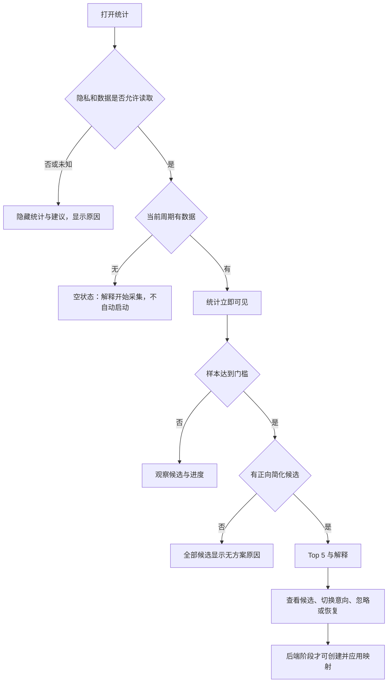

# Phase 2 产品方案：统计洞察与可解释推荐

版本：产品决策确认版 v0.2；日期：2026-10-01。状态：**D1–D5 已全部确认，增量 A 待开发，尚未验收**。

本方案依据当前 [PRD](../PRD.md)、[技术架构](../TECHNICAL_ARCHITECTURE.md)、[路线图](../ROADMAP.md) 和实际代码细化。用户于 2026-10-01 回复“均同意”，确认 D1–D5 全部采用推荐方案。已完成的 Phase 1 范围保持不变；方案批准不是功能完成或实机验收证据。物理评分公式仍留待增量 B 单独定稿，本次确认没有替它选择权重。

## 1. 产品目标与用户价值

目标用户仍为希望优化键盘使用的 macOS 用户，尤其是自定义键盘用户，不限定职业。

Phase 2 帮助用户回答三个问题：

1. **我经常按什么？** 看当前周期的快捷键、使用次数、应用分布和裸键强度。
2. **哪些组合值得简化？** 根据实际观测频率和可减少的按键数排序，而不是生成泛泛的快捷键教程。
3. **依据是什么，能否直接使用？** 分清样本、逻辑简化、物理证据、后端支持及冲突检查状态。

产品闭环：打开统计 → 找到高频组合 → 查看解释/限制 → 保留关注或忽略 → 后端阶段接入后再进入映射创建。Phase 2 首批价值是理解与筛选；不把尚未实现的应用动作作为完成条件，也不以“点了预览”冒充成功改键。

成功标准是用户能从实际数据中识别高频组合、解释一项排名、辨别不可应用的原因，并可恢复被忽略项。无数据、无改进空间同样应有完整体验，不以强行生成推荐为成功。

## 2. 仓库现状：可以复用什么

以下为本次阅读代码确认的现状，不是本方案新增功能已完成的声明。

| 能力 | 当前实现 | 需要补齐 |
|---|---|---|
| 采集、聚合、加密、隐私关闭 | Phase 1 已完成限定范围验收 | 复用其数据和生命周期，不另建采集链 |
| 资格、衰减、排序、作用域 | `AnalysisEngine` 已实现 20 次/2 日、14 活跃日、70% 和确定性排序 | 产品接入、状态细化、完整需求覆盖 |
| 原生双语仪表盘 | `AnalysisDashboardView` 有推荐、统计、应用和裸键强度 | 调整信息层级；产品 `ProductScreens` 仍使用 `AggregateFlowView` |
| 推荐候选 | 最多三个逻辑预览；有 Fn 未知和持续类排除 | 未做后端支持/冲突校验，没有应用或导出能力 |
| 布局 | 加密偏好、选择/跳过、一次询问字段和保存通路存在 | 首次展示/关闭/保存失败语义和正式入口验证 |
| 忽略项、特殊键池 | 偏好字段和分析输入存在 | 完整操作入口、持久化动作、恢复与校验 |
| 推荐作用域选择 | 原型使用视图局部状态 | 明确选择是否保存、是否影响分析；首批建议只作会话内意向 |
| 物理证据与评分 | 架构有证据链要求，逻辑引擎尚不接受完整输入 | 几何解析、变换解析、物理成本细则与失效行为 |
| UI 验证 | 原型有历史局部截图、键盘/VoiceOver 反馈 | 不等同于本次产品集成后的完整验证 |

实现依据：[分析模型](../../Sources/KeyRecordAnalysis/AnalysisModels.swift)、[引擎](../../Sources/KeyRecordAnalysis/AnalysisEngine.swift)、[候选生成](../../Sources/KeyRecordAnalysis/LogicalPreviews.swift)、[仪表盘](../../App/KeyRecordApp/AnalysisDashboardView.swift)、[候选视图](../../App/KeyRecordApp/AnalysisCandidateView.swift)、[产品入口](../../App/KeyRecordApp/ProductComposition.swift)、[原型记录](IMPLEMENTATION.md)。

## 3. 交付范围与完成口径

已确定按两个可交付增量推进，沿用既有 G2，不增加新门禁。

| 增量 | 用户得到什么 | 完成边界 |
|---|---|---|
| **A：统计与逻辑建议预览** | 真实聚合接入、易读统计、Top 5 逻辑预览、完整原因解释、布局设置、忽略/恢复、明确不可应用状态 | 可交付使用，命名为“Phase 2 统计与预览增量完成”；不宣布完整 Phase 2/G2 完成 |
| **B：完整分析要求** | 后端能力约束输入、用户确认特殊键池、手动候选与风险确认、物理证据与评分/回退、完整需求矩阵 | FR-R/FR-E 及既有 G2 标准满足后才宣布 Phase 2 完成；真实后端证据未就绪时保留明确限制 |

Phase 3/4 承担外部配置写入、读回、回滚、紧急停用以及设备集成。Phase 2 可以实现纯函数与受控合成输入上的能力/证据处理；真实适配器未提供可信输入时，运行产品仍显示未验证，不从测试结果推断兼容性。

首批不加入多周期对比、时间范围筛选、站点级统计、设备级归属、云端推荐、统计导出或健康评分。这些不属于当前方案的必要用户闭环。周期重置沿用现有语义；旧周期摘要没有足够明细，不能生成与当前周期同等的推荐。

## 4. 信息架构与页面草图

**已确定采用“统计优先”**：菜单保留采集控制，新增/明确“打开统计”；主窗口提供“概览 / 全部候选 / 设置”。同意说明仍可从设置访问，未同意时走原有同意流程，打开窗口本身不启动采集。

概览包含推荐摘要，保留首页 Top 5；“全部候选列表”移到独立可达页面。D2 已确认，PRD R7/FR-R4 与 UX 描述同步此变化，避免长列表挤压统计。未实现的映射/备份功能不放置无意义的可点击空入口。

```text
当前周期                 已暂停 / 采集中 / 隐私保护中
快捷键 128 次    裸键 64 次    活跃日 3 天

高频快捷键                        应用分布
⌘⇧C   40 次   [查看详情]           文本编辑 60% ...
⌘A    28 次   [查看详情]           未知应用 10%

值得关注的简化方案                         [全部候选]
⌘⇧C → ⌘C    3 键 → 2 键，逻辑口径
40 次 / 3 个自然日；主要应用：文本编辑
未验证应用兼容性及冲突，不能直接应用
[为什么] [候选详情] [忽略]

裸键使用强度                            [查看全部]
键码对应标签、次数与相对强度条
```

图中数据为说明用样例；⌘C 可能已有应用行为，不能把这个例子理解为建议用户立即改成它。

概览默认各展示前 10 个快捷键/应用，裸键前 12 项，均可查看全部；Top 推荐最多 5 项。数字是界面设计建议，待实现时用大数据量和小窗口验证。详情在同一窗口的可返回页面或详情区域打开，640×480 时保持单列、滚动和返回焦点，不强制双栏。

## 5. 统计与数据口径

### 5.1 周期和刷新

- 只展示当前周期。总次数为原始聚合；“活跃日”包含只有裸键活动的日期，不代表连续使用天数。
- 展示可见快照的统计，不另行记录逐键时间；排序权重不是实际次数，不写成“最近 14 天实际使用 N 次”。
- 面板可见时建议合并刷新，常态不高于每秒一次；后台不为 UI 重复全量排序。隐私关闭必须立即清除，不等待刷新节流。
- 展开详情、键盘焦点和当前滚动位置不因每次计数变化重置；导航返回恢复焦点。后台变化的排名在下一次稳定更新呈现，不让正在操作的按钮跳动。
- 分析失败与原始统计失败分开：分析失败时，隐私允许且同周期的可信原始汇总仍可见，推荐显示不可用；隐私状态未知时两者均隐藏。持久化失败继续使用 Phase 1 的明确错误状态，不声称已保存。

### 5.2 快捷键

- 主行展示组合、原始次数及可读应用信息；“当前周期次数”默认降序。详情展开加权频率、侧别、Fn、来源和分类。
- 显示层可以合并已知左右侧变体，但未知侧必须单列；详情保留各精确变体。**资格与候选按原有精确和弦计算，不因展示合并而偷偷合并门槛。** 例如左侧 12 次、右侧 12 次显示合计 24 次，并不意味着各候选已达到 20 次。
- 键码不等于输入字符。可读标签采用系统特殊键名或明确的键码/ANSI 参考标签；未知键显示“键码 N”。不读取用户输入文本来美化标签，不把历史事件按当前输入法反推字符。
- 持续类组合如 Cmd-Tab 保留统计，标注“持续操作，不参与推荐”；系统组合标注系统类别。

### 5.3 应用分布

- 仅统计快捷键，不给裸键补造应用归属。总览占比按原始次数计算，未知应用计入分母。
- 候选的“高频应用占比”按衰减后的频率计算，与总览占比区别标注。
- 首批不提供会让用户误以为所有面板均被过滤的全局应用筛选；单个快捷键详情只展示该组合的应用分布。应用名可读解析失败时回退 bundle ID；不联网获取图标或名称。
- 浏览器只到整个应用，不展示网站或窗口标题。不可判定前台触发隐私关闭，不能简单归入“未知应用”。

### 5.4 裸键强度与“热力图”

首批建议采用键码网格/列表和相对强度条：次数最高项为 100% 强度，同时显示真实次数并提供屏幕阅读器文本。明确“键码使用强度，不代表物理键位或手指负担”。

有可验证的键码到几何位置对应关系时，后续才显示几何热力图；无法映射的项目保留列表。选择 ANSI/Alice 等预设只补充几何，不足以把固件改键后的观测当成真实物理动作。此为 PRD 热力图的保守呈现细化，不新增设备跟踪。

## 6. 推荐状态、排序与操作

### 6.1 三个维度分开

| 维度 | 状态 | 用户含义 |
|---|---|---|
| 样本资格 | 不足 / 达标 / 持续类排除 | 是否满足原始次数和日期要求；达标不保证有简化方案 |
| 简化方案 | 未找到 / 逻辑预览 / 物理证据支持 | 是否有候选、采用哪种估算口径 |
| 应用准备度 | 未验证 / 不支持 / 有冲突 / 可进入映射创建 | 后端能力和冲突结果；首批只能是未验证 |

“已忽略”是独立用户偏好，不抹掉上述事实。样本不足也可以查看详情；用户主动创建映射不受 20 次门槛限制，但仍须后端支持和安全校验，持续类始终不可映射。

**D3 已确认：** 首页 Top 5 只放“样本达标、未忽略、有正向简化候选”的项目；达标但无候选的项目留在全部候选，明确原因。现有代码仅过滤样本资格与忽略项，这是已批准但尚待实现的规则变化。保留 20 次/2 日的资格定义，不用界面筛选改写它。

### 6.2 固定规则与解释

- 20 次/2 个本机自然日不变；19 次或仅 1 日的候选显示两个独立进度，不能承诺“再等一天一定有推荐”。
- 14 个活跃日半衰期只影响排名；无活动的日历日不会自动衰减。日期回拨/重启复用已有活跃日顺序，旧数据未知的顺序不猜测。
- 沿用逻辑原型的“加权频率 × 每次最多减少的逻辑键数 × 来源系数 × 布局系数”，并按规范和弦序打破同分。系数不是统计学概率，不能显示“75% 确定安全”。
- 来源普通占比 ≥95% 为 1.0，≥50% 为 0.75，其余为 0.5；无布局 0.5、有预设 0.75。这是现有原型常量，不宣称科学校准。本轮不随意调参；选择预设只会改变该因子，不自动获得物理证据。
- 候选说明优先展示真实次数、日期、原组合/候选键数和主要应用；完整公式和系数折叠在“为什么”。无候选时显示“未找到可减少按键数的组合”，不显示误导性的“推荐节省 0 键”。
- 减少量必须绑定具体候选：“此逻辑预览每次少 1 键”。不显示省时、健康收益或把周期频率直接乘成未来保证收益。

### 6.3 候选详情与作用域

详情展示最多三个逻辑预览，逐项显示键数差、估算口径及未验证原因。首批无“应用”“导出”按钮，提供“为什么未验证”说明；不鼓励复制候选绕过冲突检查。

全局/高频应用选择沿用 70% 规则，未知归属进分母但不可作为候选应用；无已知应用时应用选项禁用并说明；系统组合默认全局。该选项首批只作当前详情会话内的映射意向，不改变统计计数和全局排名，也不声称设置已生效。离开后回到计算出的默认值，并明确提示。正式草稿持久化归后端映射流程。

当以后用户改变作用域或触发组合，必须重新检查适用性和冲突；应用范围内的潜在次数只按该应用频率解释，不借用全局次数扩大收益。

### 6.4 忽略与恢复

已确定首批提供“忽略此组合”，从 Top 5 移除但保留统计和全部候选；操作后可撤销，在“已忽略”筛选中可恢复。忽略作用于精确候选 ID，跨周期保留，符合已有偏好与重置语义；不合并未知侧、不同 Fn 或不同侧别候选。

“已忽略”管理必须列出全部持久化忽略项，不能只过滤本周期候选。跨周期后没有新观测的旧项仍可恢复，显示“本周期暂无数据”，不补造零次历史统计；能从现有标识解析的组合正常显示，无法解析的保留可识别标识与移除操作。撤销忽略后若本周期没有该组合，它只从管理列表移除，不凭空生成推荐。

通过现有加密偏好事务保存，失败时回滚可见状态并显示重试，不能出现“按钮成功但重开丢失”。隐私关闭时不允许读写相关偏好详情。是否需要按应用粒度忽略不在首批范围。

### 6.5 菜单徽标

保持 PRD 的非打断式提示，只在出现新的可展示 Top 5 项时标记，不因次数增长/排序换位反复提示。打开推荐区域后清除当次提示。首批建议已查看集合仅保留在进程会话内，冷启动先建立当前集合，不把所有旧项目都视为“新推荐”；关闭隐私内容时不暴露组合或数量。无需增加事件历史或持久化快照。

## 7. 布局、特殊键池与完整物理路径

### 7.1 布局询问

首次出现样本达标候选时，在概览显示一次非模态询问，选项为 ANSI / ISO / Alice / 分体 / 暂不选择。无候选时可从设置主动修改。不得挡住统计或要求输入才能继续。

建议选定或显式跳过后持久化 `hasAsked`；仅看到但未操作不写偏好，可留在原位置但不弹窗、不重复通知。保存失败保留原值、展示错误并允许重试；成功后可在设置随时修改。修改后重算分析，统计数据不变；周期重置不重复询问。

### 7.2 特殊键池和手动候选（增量 B）

通过设置中的可选“可用于简化的特殊键”建立用户确认池。默认空，使用点击选取标准功能键的方式，避免新增全局按键录制；用户确认只表明愿意考虑该键，**不代表无冲突**。撤销后所有相关预览重算。

手动候选编辑器只接受标准键码/修饰键，列出原组合与新组合。自动候选绝不含裸可打印键；手动选择裸可打印键时必须显示风险与显式二次确认，取消不保存。首批无编辑器；该要求保留到 B，不能以“现在没有按钮”宣称 FR-R7 全部完成。后续映射仍需能力/冲突检查，确认风险不能绕过它们。

### 7.3 证据状态和后端能力（增量 B）

完整输入必须包含几何、已验证固件映射和相关系统/软件变换，以及后端支持和约束。复用架构已有的证据类型、规则版本与验证机制，不新加冻结合同或平行门禁。

纯解析只接受唯一且无歧义的动作；缺失、未知、外部变化、多设备不确定或不支持时回退逻辑口径。来源组合与候选都必须能在同一口径下比较，不能把一个物理成本减去另一个逻辑键数。UI 对每项列出采用/缺失的证据类别，不泄露或要求用户阅读内部哈希。

后端输入采用明确状态：未连接/不支持/支持但未检查/冲突/检查通过。未知不能当通过；修改布局、作用域、键池、规则或后端输入后重新计算。即使分析允许进入映射创建，也不执行外部写入；后端阶段在提交时重新校验。

### 7.4 物理成本细则：现有方案尚未定稿

架构定义了 `physicalCost(gesture, geometry)`，但目前没有足够具体、已评审的计算规则。**不能把这个名字或选择布局当作“基础人体工学评分已实现”。**

建议 B 的规则设计以“可解释的动作成本”起步：分别输出唯一解析出的物理按下次数与同一组合的几何跨度，跨分体区域只有坐标关系已知时才比较。距离使用布局的标准键距单位；不推断手指、手掌大小、疲劳或疼痛。次数减少与几何跨度变化分别展示，不能把距离换算成“少按几次”。

D5 已确定将物理评分留到 B 单独定稿。A 继续使用已实现的逻辑公式，完整 FR-E1/G2 保持未完成。B 开始时先提交有限的几何样例、计算表和排序反例，再决定是否及如何把次数和跨度合成排名权重，确定常量及规则版本后实现；未决常量不进入代码。真实证据接入缺失时只验证模型回退，不宣称真实人体工学收益。

## 8. 关键流程与状态



该图采用已确认的 D3 方案。完整状态约定：

| 状态 | 页面行为 | 可用动作 |
|---|---|---|
| 首次启动、未同意 | 本地统计说明和原有同意流程 | 接受/拒绝；不展示虚构统计 |
| 已同意但无数据 | 解释统计将在合法采集后出现 | 用户主动 Start；不自动启动 |
| 样本不足 | 统计 + 观察候选 + 两项进度 | 查看详情；不诱导持续采集来解锁功能 |
| 样本达标但无方案 | 保留统计和原因，如 Fn 未知、无更短候选 | 查看全部候选/设置；不保证配置后一定有推荐 |
| Paused 且隐私允许 | 保留允许读取的已保存/当前可信统计 | 查看、设置、显式 Resume |
| 锁屏/Secure Input/权限失效/隐私未知 | 清除所有敏感文字、图形、详情和 AX 内容 | 仅显示原因及已有安全恢复入口 |
| 分析失败但聚合可读 | 显示可信统计，推荐区错误状态 | 重试分析；不开采集、不覆盖旧数据 |
| 存储不可读/密钥问题 | 隐藏内容，沿用 Phase 1 错误处理 | 不静默重置、不创建替代密钥 |
| 偏好保存失败 | 保持上次成功值，显示失败 | 重试或取消 |
| 重置周期 | 沿用既有确认；新周期为空 | 不恢复旧明细；忽略项和布局按合同保留 |

读数据、分析和发布均复用现有生命周期代次校验；旧周期或隐私关闭前的异步结果不得重新填回屏幕。Pause 不等于锁屏，打开统计不等于 Resume，自动分析不等于授权采集。

## 9. 文案、可访问性与呈现规范

采用现有原生组件、系统字体、语义颜色、双语目录，不另起设计系统。常用文案：

| 场景 | 中文 | English |
|---|---|---|
| 门槛不足 | 观察中：18 次，已分布在 2 个自然日 | Observing: 18 uses across 2 local days |
| 达标无方案 | 样本已达标，暂未找到更简单的组合 | Sample threshold met; no simpler combination found |
| 预览 | 逻辑简化预览，尚未验证兼容性与冲突 | Logical preview; compatibility and conflicts not checked |
| 来源 | 普通观测不代表已验证的真实输入 | Ordinary observations are not proof of authentic input |
| 侧别 | Command（侧别未知） | Command (side unknown) |
| 原因说明 | 选择布局预设不代表已验证固件映射 | A layout preset does not verify firmware mapping |

颜色不能单独表达推荐或错误；图形同时提供次数文字。候选状态、次数、估算口径和不可用原因均可被 VoiceOver 读取。Tab 顺序跟视觉顺序一致，详情返回恢复触发控件焦点，Escape 关闭详情/确认但不默认执行删除。中英文、长应用名、窄窗口、深浅色、高对比度和动态文字不截断关键内容。

不在采集过程中高频朗读计数；由用户聚焦读取当前值，重要状态变化才提供适量通知。隐私关闭时同步移除可访问性树中的敏感内容，不能仅盖一层遮罩。

## 10. 开发拆分与验收

实施顺序建议：数据与状态契约梳理 → 产品入口和概览 → 候选/忽略/布局闭环 → 自动化边界验证 → 集中界面检查 → 增量 B。这里的“契约梳理”指沿用已有类型和约束，不新建冻结 contract、hash 或 baseline。

| 工作包 | 产物 | 主要验证 |
|---|---|---|
| 1. 接入 | 复用受保护分析快照，产品可打开概览 | 同意/暂停/隐私状态、过期异步结果、周期切换 |
| 2. 统计 | 快捷键/应用/裸键、详情、未知标签 | 合计守恒、侧别、原始/加权区别、空/大数据、标签回退 |
| 3. 预览 | 状态拆分、Top 5、解释、会话内作用域 | 门槛、无候选、同分、70%、系统组合、最多三个 |
| 4. 偏好 | 忽略/撤销/恢复，布局选择/跳过 | 加密保存、失败回滚、重开和周期重置保留 |
| 5. 体验 | 双语、键盘、VoiceOver、非打断徽标 | 合成场景截图/交互检查、隐私关闭 AX 清除 |
| 6. 完整分析 | 能力约束、手动候选、特殊键池、物理解析 | 冲突/未知不通过、风险确认、同口径比较、完整链与每种回退 |

需求追踪：

| 既有要求 | A 的覆盖 | B / 完整完成需要 |
|---|---|---|
| FR-R1 确定性与解释 | 逻辑引擎与解释接入 | 新能力/物理输入的确定性与规则版本验证 |
| FR-R2 门槛 | 19/20、1/2 日、日期回拨、左右变体 | 无额外门槛变更 |
| FR-R3 衰减 | 14 活跃日、裸键活跃日、重启一致 | 新评分不改变资格 |
| FR-R4 数量上限 | Top 5/全部/每项 ≤3；按已确认的 D2 页面位置与 D3 筛选实现 | 新触发源仍遵守上限 |
| FR-R5 声明边界 | 逻辑口径、无时间/健康承诺 | 物理证据唯一有效、减少量单位一致 |
| FR-R6 作用域 | 70%、未知分母、同分、无已知应用 | 与后端草稿/校验衔接 |
| FR-R7 触发约束 | 自动无裸可打印键 | 手动选择及高风险确认、后端约束 |
| FR-E1 几何与证据链 | 预设/跳过与明确逻辑回退 | 完整链消费、物理成本细则、歧义/外部变化处理 |
| FR-E2 询问时机 | 首次达标、成功保存/跳过后不再问 | 不因后端接入重新打扰 |
| FR-U1–U4 相关体验 | 菜单可达、徽标、双语、键盘/VoiceOver | 新 B 控件同样覆盖 |

自动场景直接构造跨日数据，无需用户等两天或反复按键。至少覆盖：未达标、达标无方案、正向预览、全忽略、Fn 未知、持续类、系统类、未知应用、来源可疑、保存失败、隐私关闭、旧分析晚到及重启。

性能只针对新增分析/渲染测量：用代表性规模和大数据压力样例检查计算时间、峰值内存及界面响应，整体仍遵守既有资源预算。若数据规模/刷新策略导致超标，针对相关部分修复；不默认重跑整套 Phase 1 锁屏/Keychain/性能验收。

用户配合集中在自动结果稳定后的一次界面走查，建议预留约 5–10 分钟、按步骤停在就绪点；真实采集段另定短时限。先说明动作再启动，不用全程录入、不等自然日推进。实际若涉及新的隐私边界代码改动，再针对变化增加必要验证；不能为了减少配合省掉安全检查。

没有联网埋点。产品效果使用本地合成场景、可复现测试和自愿反馈判断；不记录逐次打开、点击或输入事件。

## 11. 发布、升级和回退

首批保持现有试验身份和平台支持范围，更新不替换日常身份或读取日常库；签名续期是交付准备项，不是扩大平台支持的理由。按用户既有授权执行签名/自动验证并交独立 reviewer 校验；需手动界面动作时先协调就绪。

优先复用现有加密偏好字段和每日聚合，不持久化可重新计算的分析快照，不新增迁移仅为保存页面选择。新偏好操作必须保留登录项、排除项等无关设置。分析失败可回退展示可信基础汇总，不能回退隐私保护；出现需数据迁移的需求时单独设计和验证，不能承诺任意降级兼容。

本文件记录已确认设计，不把已完成 Phase 1 证据标记为 Phase 2 证据，不自动替换已安装 App。

## 12. 已确认的产品决策

确认时间：2026-10-01；依据：用户对 D1–D5 回复“均同意”。下表推荐方案全部采用，备选仅保留为取舍记录，不再是待选项。

| 决策 | 推荐方案 | 备选及代价 | 影响 |
|---|---|---|---|
| **D1：是否分批交付** | 先交付 A 的真实统计与逻辑预览，再补 B；完整 G2 保持未完成直到全部满足 | 等物理证据/后端约束齐备再开放；首个可用体验更晚 | 本轮范围、里程碑命名 |
| **D2：首页以什么为主** | 统计优先，概览内保留 Top 5，全部候选单独查看 | 推荐优先，并保持全部候选在首页展开；样本不足和无方案时首页价值偏弱 | 主导航、信息层级及 PRD 首页列表要求 |
| **D3：达标但无简化方案是否进 Top 5** | 不进 Top 5，留在全部候选并解释；门槛资格不变 | 保留现有原型行为，允许 0 减少量项目占首页名额 | 已确认的推荐展示规则变更 |
| **D4：首批是否做忽略/恢复** | 做；让用户能整理关注项，沿用已有加密偏好 | 只读浏览；实现更少，但用户看完没有管理动作 | A 的闭环与保存/恢复工作量 |
| **D5：物理/人体工学路线** | A 不做物理收益承诺，B 单独定稿动作次数/几何跨度规则及证据接入 | 本轮同时做 B；需要先确定成本公式并准备几何/变换与后端证据 | 是否扩大本轮范围；FR-E1/G2 仍需真实覆盖 |

D1 与 D5 相关但不等同：分批交付不删除 B，推迟物理评分也不能宣布 FR-E1 已通过。D2 改变全部候选的页面位置，D3 改变现有原型展示；本次同步 PRD 和架构的相应要求，产品代码与对应测试留给下列开发任务。

## 13. 首批开发任务与交付顺序

以下均为待开发任务，编号仅用于追踪，不是新门禁。产品入口任务完成前，现有原型仍不能称为产品功能。

| 任务 | 实现范围 | 依赖与完成检查 |
|---|---|---|
| P2-A1 推荐展示规则 | 保留资格模型；Top 5 增加有候选且正向减少的条件；无方案原因可解释 | 起点；先覆盖达标无候选、正向候选、忽略、同分、最多五项回归；次数/资格不变 |
| P2-A2 统计产品入口 | 将受保护 analysis 接入概览/全部候选/设置；复用同意和原始统计路径 | 依赖 A1 的状态定义；验证打开不启动、Pause 不 Resume、旧分析不能穿越隐私关闭和周期切换 |
| P2-A3 统计与详情 | 实现概览前列、查看全部、组合侧别/来源详情、应用分布、裸键强度与返回焦点 | 依赖 A2；原始/加权明确、侧别合计守恒、未知不冒充已知、裸键无应用归属 |
| P2-A4 偏好闭环 | 忽略/撤销/恢复与全部持久化忽略项管理；布局选择/跳过/改选 | 可与 A3 分模块进行；复用加密偏好事务，覆盖保存失败、重启、周期重置、无观测旧项恢复和无关偏好保留 |
| P2-A5 推荐交互 | Top 5 与全部候选、解释、会话内作用域、非打断徽标、双语可访问性 | 依赖 A2/A4；无应用/导出承诺，焦点稳定，隐私关闭清除 AX 内容，徽标不随计数反复出现 |
| P2-A6 集成验收 | 合成数据全场景、必要原生 UI 测试、针对新增分析/渲染的资源测量、一次集中人工检查 | 依赖 A1–A5；先自动再协调用户操作，结果记录为 A 的证据，不重标 Phase 1 或完整 G2 |

更新与签名续期安排在 A6 实机交付前，保持现有试验身份及数据范围。增量 B 的公式、物理证据和后端工作另行细化，不混入 A 的完成条件；相关完整需求继续保留。

本次方案只通过文档/源码一致性阅读确认现状，没有执行新产品测试。上述验收表是未来实施的验证计划，所有新增界面、持久化动作、物理成本和后端约束均不得视为已实现。
